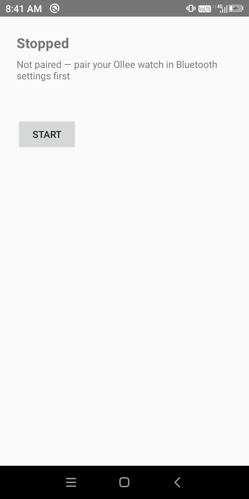
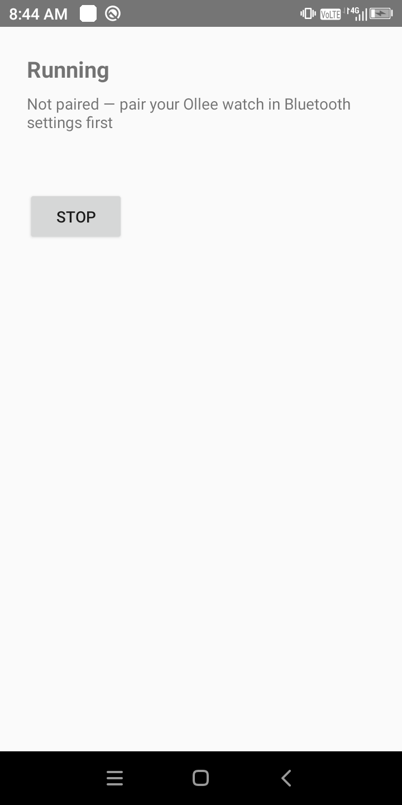
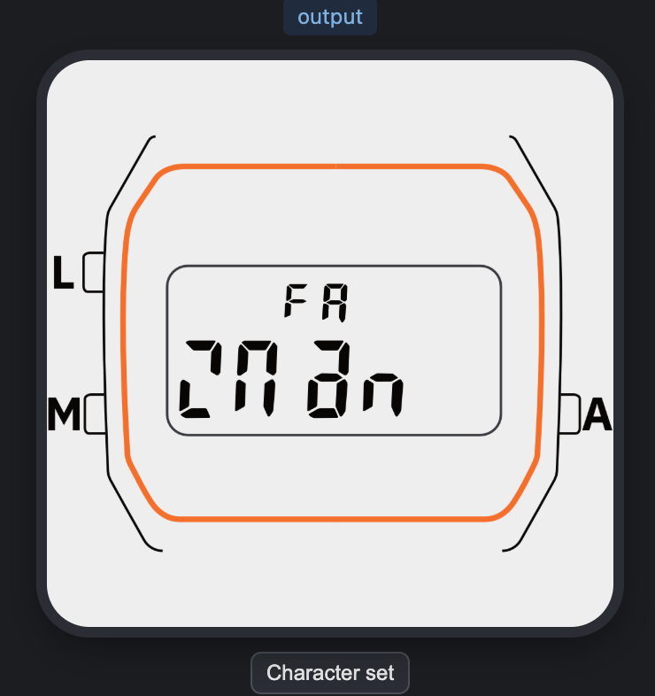
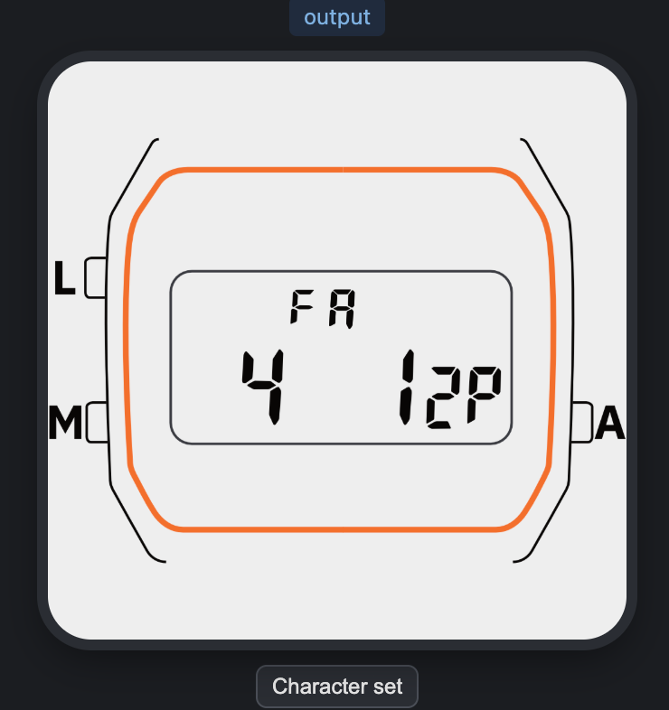
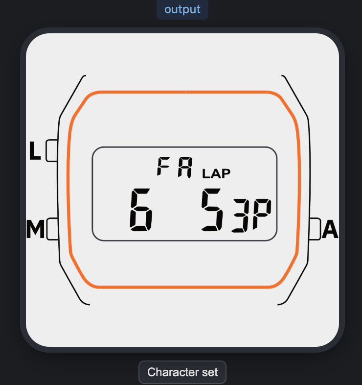

  

  
  
  
  

# 🕯️ Zmanim for Ollee

**Zmanim for Ollee** pushes halachic times (zmanim) to an [**Ollee Watch**](https://www.olleewatch.com/) — candle lighting, Havdalah, and daily tefillah times — as a custom watchface, built on the official **[Ollee Watch Forge](https://github.com/olleewatch/forge_emulator)** SDK.

Ollee Watch Forge lets you write custom watchfaces in plain JavaScript and talk to the
watch over a documented BLE GATT service — no more reverse engineering required. (It's
currently **Beta 1**: emulator support only, with on-watch deployment coming in Beta 2 —
see [Status](#status).) Earlier design work in this repo leaned on the community protocol
reverse-engineered by [FreeOllee](https://github.com/Arthur86000/FreeOllee) (Arthur86000) and
[FreeOllee-Faces / Super FreeOllee](https://github.com/kenblizzardcaron/FreeOllee-Faces)
(kenblizzardcaron); that effort is credited in Acknowledgments but is no longer the
dependency now that an official SDK exists.

Zmanim are computed from the [Hebcal](https://www.hebcal.com/) REST APIs.
No scraping, no shared credentials.

---

## What this does

- Pulls daily zmanim from the **Hebcal Zmanim API** (`hebcal.com/zmanim`) for your GPS location.
- Pulls candle lighting / Havdalah times (weekly Shabbat **and** Yom Tov) from the **Hebcal Calendar API** (`hebcal.com/hebcal`).
- A phone-side app computes the next zman and writes a short text message to the watch over
  Forge's BLE GATT service; the [`watchface/zmanim.js`](watchface/zmanim.js) Forge face just
  displays whatever it receives on the clock digits (`Ollee.drawMain`) and chimes.
- Candle lighting / Havdalah messages are flagged **urgent** and get three beeps instead of
  one — the one reminder you can't just check your phone for once Shabbat starts.
- The watchface keeps listening for messages in the background (`Ollee.subscribe(E_BLE_RX)`),
  so an urgent alert still buzzes your wrist even while another face is on screen.

Two pieces, split the way Forge intends: the **watchface** (`watchface/zmanim.js`) is a thin,
dumb display — it has no network access and does no zmanim math of its own, by design (Forge
scripts can't reach the network). The **phone app** (`app/`, Android/Kotlin) does all the Hebcal
computation and scheduling, and just writes short strings to the watch. It runs as a foreground
service: it finds the already-paired Ollee watch, connects over BLE, polls Hebcal every 5
minutes, and writes a message only when the next zman actually changes.

---

## Screenshots

### App Screenshots

From the debug build running on a real Android phone (not paired with a watch yet):

| Stopped | Running |
|:---:|:---:|
|  |  |

Starting the service here is what first caught a real threading bug: `ZmanimForegroundService`
was calling back into `MainActivity`'s UI from its background poll thread instead of the main
thread, which crashed on a real device immediately (never surfaced by unit tests alone). Fixed
by posting that callback through a main-thread `Handler`.

### Watch Screenshots

From the [Forge emulator](https://github.com/olleewatch/forge_emulator) (Beta 1 is
emulator-only — no real watch to screenshot yet):

| Idle (no message received) | Routine update | Urgent alert |
|:---:|:---:|:---:|
|  |  |  |

The idle screenshot is a good illustration of design-notes.md's "prefer digits over letters"
point: the fallback text `'zman  '` is genuinely hard to read on the 7-segment display, while
the time-formatted updates (routine and urgent) are clear. The urgent screenshot also shows the
`LAP` indicator lighting up and the emulator's speaker icon, both driven by
`watchface/zmanim.js`'s beep-chain.

---

## Status

🚧 Early WIP.

- [x] Forge watchface script (`watchface/zmanim.js`) — receives text + an urgent flag over BLE,
      displays it, chimes. Runs today in the [Forge emulator](https://github.com/olleewatch/forge_emulator).
- [x] Phone app (`app/`) — Hebcal polling, next-zman scheduling, Shabbat/Yom Tov freeze mode, BLE
      writes to the watch over Forge's GATT service. Builds and unit tests pass
      (`./gradlew assembleDebug test`); now also run on a real Android phone (not yet against a
      real watch, since that's gated on Forge Beta 2 — see below).
- [ ] On-watch deployment — blocked on Forge **Beta 2** (Beta 1 is emulator-only), so the phone
      app has nothing to actually connect to yet.
- [ ] Multiple halachic opinions (currently GRA only), manual settings UI for location/candle
      minutes (currently SharedPreferences only, no screen for them yet).

Design notes so far live in [`docs/design-notes.md`](docs/design-notes.md).

---

## Watchface

[`watchface/zmanim.js`](watchface/zmanim.js) is a Forge watchface: a single self-contained
JavaScript file, no phone-app code baked in. Test it by cloning
[olleewatch/forge_emulator](https://github.com/olleewatch/forge_emulator), opening `index.html`,
and using **Load file** to load `zmanim.js`.

**BLE message protocol** (phone → watch, over Forge's BLE service
`C6FB0001-A37D-40AC-89BE-887D25E1F5B3`, write to RX `C6FB0002-...`):

- Byte 0: `'1'` for an urgent alert (candle lighting / Havdalah), `'0'` for a routine update.
- Remaining bytes: text to show (`Ollee.drawMain` keeps the first 6 characters and
  right-pads/truncates automatically).

The watch display is a 7-segment LCD, not pixels — stick to characters that render cleanly on
it (digits render reliably; letters are hit-or-miss, see
[`docs/concepts/display.md`](https://github.com/olleewatch/forge_emulator/blob/main/docs/concepts/display.md)
in the Forge repo). The phone app is expected to pre-format text (e.g. a time like `4:12P`)
rather than relying on the watch to do any formatting.

---

## Phone app

`app/` is a plain Android/Kotlin app (no third-party dependencies — platform BLE, location,
and HTTP APIs, `org.json` for parsing). `ZmanimForegroundService` does the real work:

1. Finds the already-paired Ollee watch (by name, among bonded Bluetooth devices — pairing
   itself still happens in Android's Bluetooth settings) and holds a BLE GATT connection to it.
2. Every 5 minutes, fetches today's zmanim and any Shabbat/Yom Tov candle-lighting/Havdalah
   windows from Hebcal, and figures out the next one up (`ZmanSchedule`, pure logic, unit tested).
3. Writes a message to the watch only when that next zman actually changes — not every poll.
4. On crossing into a Shabbat/Yom Tov window, sends one urgent message and then **freezes**
   (no more Hebcal polling, no more BLE writes) until Havdalah — see design-notes.md's
   "Shabbat / Yom Tov mode".

Build it with `./gradlew assembleDebug`, run tests with `./gradlew test`.

### Configuration

Currently via `SharedPreferences` only (`Prefs.kt`) — no settings screen yet:

- **Location** — a manual lat/lon override if set, otherwise the platform `LocationManager`'s
  last known fix (no Google Play Services dependency, same as Super FreeOllee's
  GrapheneOS-friendly approach). Hebcal needs `latitude`/`longitude` (not `lat`/`lon`) and a
  `tzid` — the app sends the device's current timezone.
- **Candle-lighting minutes** — minutes before sunset, default 18 (Hebcal's `b=` param).
- Halachic opinion is currently fixed to GRA; MGA/Baal HaTanya (which Hebcal returns in the
  same response) are a documented open question in design-notes.md, not yet exposed.

---

## License

This project is licensed under the MIT License. See the [LICENSE](LICENSE) file for details.

---

## Contributing

Pull requests are welcome. Open an issue first to discuss ideas or report bugs — see
[CONTRIBUTING.md](CONTRIBUTING.md).

---

## Acknowledgments

* [Hebcal](https://www.hebcal.com/) — Jewish calendar and zmanim data
* [Ollee Watch Forge](https://github.com/olleewatch/forge_emulator) — the official watchface SDK this project is built on
* [FreeOllee](https://github.com/Arthur86000/FreeOllee) — original Ollee BLE protocol reverse engineering (historical reference, no longer a dependency)
* [FreeOllee-Faces / Super FreeOllee](https://github.com/kenblizzardcaron/FreeOllee-Faces) — full protocol
  documentation and reference implementation (historical reference, no longer a dependency)
